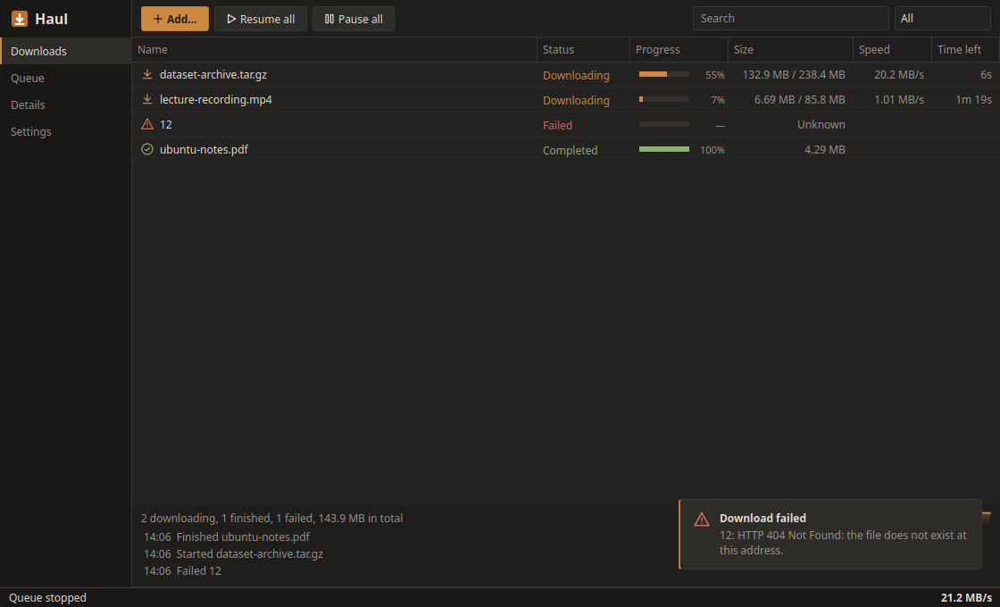
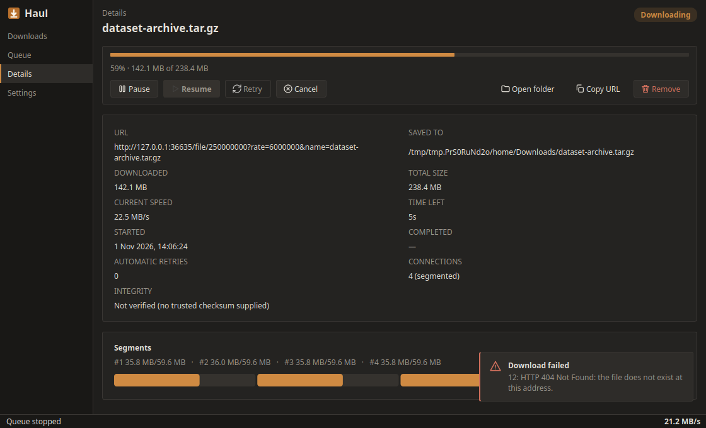
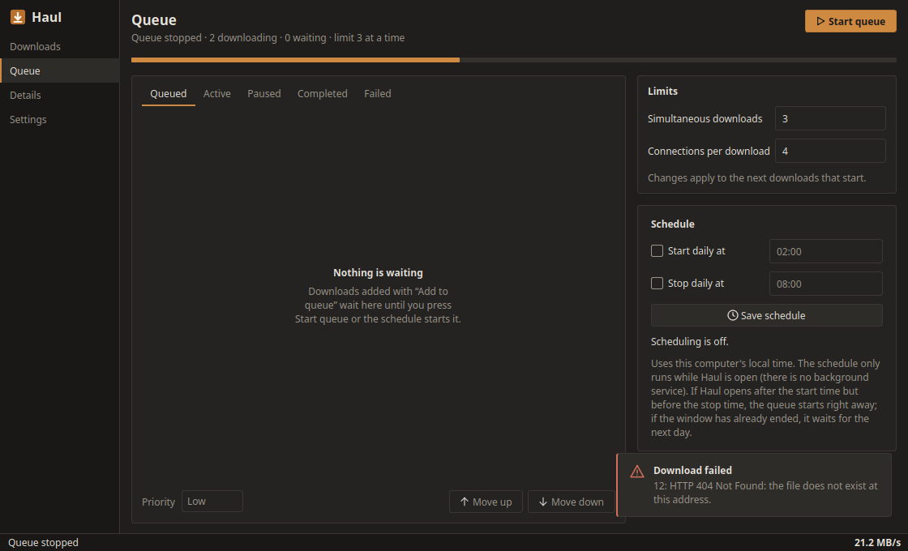
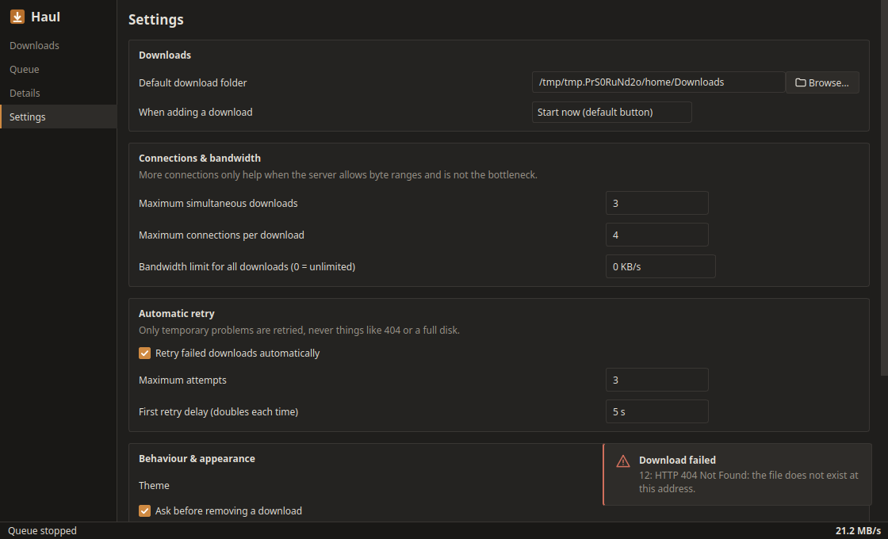

# Haul

**Haul** is an open-source desktop download manager for **Linux and Windows**, written in **C++17** with **Qt 6 Widgets**, **libcurl** and **SQLite**. It resumes interrupted downloads safely, uses several connections when a server allows it, queues and schedules downloads, and keeps a persistent history. It needs no account and no cloud service.

It began as a first-semester Programming Fundamentals project at SEECS, NUST. Its feature set was inspired by the publicly described features of Internet Download Manager and implemented clean-room (see [docs/FEATURE_RESEARCH.md](docs/FEATURE_RESEARCH.md)). Haul is not affiliated with or compatible with IDM.



| Download details (4 segments) | Queue & scheduler | Settings |
|---|---|---|
|  |  |  |

*The screenshots were produced by `tools/capture_screenshots.sh` from real application state, using real downloads from the local test server.*

## Features

- **Real HTTP/HTTPS downloads** with live progress, a smoothed speed, and an ETA shown only when it is meaningful.
- **Pause and resume** with `Range` and `If-Range`. Every `206` response is checked against the requested `Content-Range`. If the server ignores the range or the file changed, the download restarts cleanly; data is never blindly appended.
- **Segmented downloads** (up to 16 connections). Each segment goes to its own file, every range is verified, and the file is assembled before the final rename. Haul falls back to one connection automatically when the server ignores ranges.
- **Queue:** priority then FIFO, simultaneous-download limit, Start/Stop queue, Move up/down, duplicate prevention.
- **Scheduler:** daily start and optional stop time (windows across midnight are supported), with a documented missed-start policy.
- **Automatic retry:** bounded exponential backoff for transient errors only. `Retry-After` is honoured. 404, 403, TLS and disk errors are never retried.
- **Global bandwidth limit**, shared across running downloads.
- **Persistence and recovery:** SQLite history with migrations. Downloads interrupted by a crash or by closing the app come back as *Interrupted* and are revalidated before resuming.
- **Integrity:** optional SHA-256 verification against a checksum you supply (shown as *Verified*, *Mismatch* or *Not verified*).
- **Safety:** http/https only, including redirects. TLS verification is always on. Server-supplied file names are sanitised, and existing files are never overwritten.
- **Polished UI:** dark and light themes, statistics with a live speed graph, search and filters, context menus, keyboard shortcuts and empty states.

## Technology

| | |
|---|---|
| Language | C++17 |
| GUI | Qt 6 Widgets (+ Qt Svg, Qt Concurrent) |
| Networking | libcurl (easy and multi interfaces) |
| Storage | SQLite 3 (raw C API, prepared statements), `QSettings` |
| Build | CMake ≥ 3.21 with presets, Ninja |
| Tests | Qt Test + CTest + a local Python standard-library HTTP server |

## Architecture

```
haul (main.cpp)
 └─ haul_ui      MainWindow, five screens, Theme, model/delegate, widgets
     └─ haul_engine
          app/        DownloadManager (life cycle, retries, persistence)
          network/    DownloadWorker (one QThread each), HttpProbe, HttpDownloader, SegmentDownloader
          scheduler/  DownloadQueue, Schedule/Scheduler
          storage/    Database (migrations), DownloadRepository, SettingsRepository
          core/       DownloadTask, TaskState, validation, formatting, retry policy, rate limiter, ...
          platform/   data paths, launch at login
```

Workers never touch widgets; they report through queued signals. See [docs/ARCHITECTURE.md](docs/ARCHITECTURE.md).

## Building on Linux

Verified on Ubuntu 26.04 (Qt 6.10, locally) and Ubuntu 24.04 (Qt 6.4, in CI). It needs Qt ≥ 6.4, libcurl ≥ 7.85 and CMake ≥ 3.21.

```bash
sudo apt install build-essential cmake ninja-build pkg-config \
                 qt6-base-dev qt6-svg-dev libcurl4-openssl-dev libsqlite3-dev python3
git clone https://github.com/tehsaad/Haul.git && cd Haul
cmake --preset linux-release
cmake --build --preset linux-release
./build/linux-release/src/haul
```

Debian packaging (`.deb`) lives on the `feature/linux-desktop` branch; see `packaging/linux/README.md` there.

## Building on Windows

Verified in CI with Visual Studio 2022 (MSVC x64), Qt 6.8.3 `msvc2022_64`, and curl and sqlite3 from vcpkg:

```powershell
vcpkg install curl:x64-windows sqlite3:x64-windows
cmake --preset windows-msvc -DCMAKE_TOOLCHAIN_FILE=%VCPKG_ROOT%/scripts/buildsystems/vcpkg.cmake -DCMAKE_PREFIX_PATH=C:/Qt/6.8.3/msvc2022_64
cmake --build --preset windows-msvc
```

Run this from a "x64 Native Tools" prompt. The installer (NSIS) and the GitHub Actions workflow that builds it live on the `feature/windows-desktop` branch; see `packaging/windows/README.md` there.

## Usage

Click **Add download** (Ctrl+N), paste a link, then choose **Start now** or **Add to queue**. See the [User Guide](docs/USER_GUIDE.md). From a terminal: `haul --add <url>`.

## Testing

```bash
cmake --preset linux-debug && cmake --build --preset linux-debug && ctest --preset linux-debug
```

Six suites cover the engine, storage, queue, network behaviour (ranges, ignored ranges, wrong `Content-Range`, changed files, errors, cancellation, segmentation) and the GUI. On 2026-10-24 all 6 passed locally (136 QtTest results), in Linux CI (Qt 6.4) and in Windows CI (MSVC, Qt 6.8.3). The worst measured GUI stall during an active download was 14 ms. Details, and an honest benchmark of when multiple connections help, are in [docs/TESTING.md](docs/TESTING.md).

## Media detection

The browser extension watches the responses a page actually receives, so it works on extensionless and signed links, redirects and files a player fetches in the background, with no list of supported sites.

| | |
|---|---|
| **Video** | MP4, MKV, WebM, MOV, AVI, FLV, TS, M4V, MPEG, MPG, 3GP |
| **Audio** | MP3, WAV, FLAC, AAC, M4A, OGG, Opus, WMA |
| **Streams** | HLS (`.m3u8`), MPEG-DASH (`.mpd`) |

A response counts only if its status, type and size make sense: a `.mp4` address that returns a web page is ignored, and pieces of a stream aren't listed as files. When a page loads media, the list pops up by itself for a few seconds and a **Download with Haul** button appears on the video. If you ignore the list, it shrinks to a small indicator. Haul reads each file's first bytes only when you click or hover over the list, to confirm its real format, size and resume support. Files whose bytes turn out not to be media disappear from the list.

Estimated values are marked with ≈. Downloads go through the normal manager, so queues, retries, resume and checksums all apply.

## Video streams

Haul downloads ordinary video files and unencrypted HLS (`.m3u8`) and MPEG-DASH (`.mpd`) streams, from any site that serves them that way. It lists the qualities a stream offers and estimates the size. Pieces download several at a time, failed pieces are retried, and a stopped download resumes without fetching finished pieces again. Paste a manifest address into the Add dialog, or let the browser extension find it.

[FFmpeg](https://ffmpeg.org) is optional and not bundled. Without it, most streams still produce a playable file, but `.ts` streams stay `.ts`, and videos with separate picture and sound are saved as two files. Install it (`sudo apt install ffmpeg`, or put `ffmpeg.exe` next to Haul on Windows) and Haul uses it automatically.

Haul stops with a clear message on encrypted streams (DRM, AES-128 or SAMPLE-AES), live streams, and anything that refuses access. It does not decrypt, remove DRM, get around logins or paywalls, or contain code for specific sites. YouTube is excluded. Only download what you have permission to download.

## Browser extension

1. In Haul, open **Settings → Browser**, tick **Allow the browser extension** and press **Save**.
2. Click **Show extension folder**, then load that folder in `chrome://extensions` (Developer mode → Load unpacked) or in Firefox's `about:debugging`.
3. That's it. Downloads you start in the browser now open Haul's Add dialog instead, and a list pops up on pages with audio or video, with a button on the video itself. Choose a file or quality and press **Download**. You can also right-click a link and choose **Download with Haul**. Nothing starts until you confirm in Haul.

The extension's popup can turn off the takeover, the pop-up or Haul's presence on pages, and reopen a hidden list. On Linux with Wayland, Haul runs through XWayland so its dialog can appear in front of the browser; set `QT_QPA_PLATFORM=wayland` if you prefer native Wayland.

## Known limitations

- Logins are typed by hand and forgotten when Haul closes. Haul does not read cookies or passwords from your browser, so a download that depends on a browser session needs its cookie pasted in.
- Encrypted video, live streams, DASH split into several periods, and YouTube aren't downloaded. Some sites build their streams in ways Haul can't see from the browser, so the indicator won't appear on every site. Haul identifies itself honestly and doesn't use your browser's cookies, so some servers will refuse it. When that happens, a download you started stays in the browser, and the panel offers **In browser** instead.
- FTP downloads use one connection. Plain `ftp://` is unencrypted; use `ftps://` when the server offers it.
- The browser extension isn't in the Chrome or Firefox stores yet. Chromium browsers load it unpacked; release Firefox only keeps unsigned add-ons until it restarts. Snap browsers (the default Firefox on Ubuntu) may block native messaging.
- The scheduler only runs while Haul is open.
- One queue. The segmentation is static: segments are not re-split while running.
- Changing "connections per download" affects downloads when they next start.
- Segmented assembly needs temporary extra disk space (up to the file size) and an extra copy.

## Roadmap

3. Per-category download folders.
4. Dynamic re-segmentation of slow segments.
5. A system tray icon and desktop notifications.

## Documentation

[Architecture](docs/ARCHITECTURE.md) · [Feature research](docs/FEATURE_RESEARCH.md) · [User guide](docs/USER_GUIDE.md) · [Testing](docs/TESTING.md) · [Security](docs/SECURITY.md) · [PF concept mapping](docs/PF_CONCEPT_MAPPING.md) · [Demo script](docs/DEMO.md) · [Contributing](CONTRIBUTING.md) · [Changelog](CHANGELOG.md)

## License

Apache License 2.0; see [LICENSE](LICENSE). Icons and artwork are original to this project. Qt is used under the LGPL v3, libcurl under the curl license, and SQLite is public domain.
